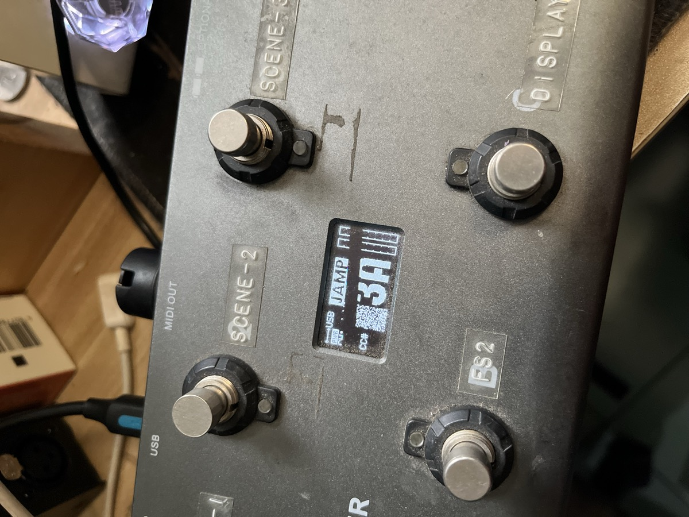

> This repo does not distribute the firmware image; build it from your own official firmware with `tools/patch_jamp_test.py`.

# v0.1.0-jamp-mod (TEST / experimental, owner-requested)

Binary-patched copy of the ORIGINAL MeloAudio MIDI Commander (TSMIDI2.0) firmware with a modified built-in **JAMP** profile, **modded to work with the Ampero II Stomp** (the JAMP footswitch CC map below matches the Ampero II Stomp MIDI assignments the owner uses). This is not the Stage B reconstruction and not the `v1.0.0-original-reconstruction` baseline. It was built locally; no GitHub CI/builds are used.

SHA-256 of app image: `1476018a0473b16c40c27439b8663b399e597f401fe3631d9c761e3e83202abe` (77,451 bytes, flashed at 0x08003000)

## JAMP footswitch CC assignments (for Ampero II Stomp)
MIDI channel is unchanged from the original JAMP setting. All values are sent on press only.

| Footswitch | CC | Value | Mode | Ampero II Stomp function |
|---|---|---|---|---|
| 1 | CC25 | 1 | Momentary | SCENE 1 |
| 2 | CC25 | 2 | Momentary | SCENE 2 |
| 3 | CC25 | 3 | Momentary | SCENE 3 |
| 4 | CC28 | 127/0 | Toggle | n/a |
| A | CC79 | 127/0 | Toggle | EFFECTS 1 |
| B | CC80 | 127/0 | Toggle | EFFECTS 2 |
| C | CC81 | 127/0 | Toggle | DLY/RVB |
| D | CC60 | 127/0 | Toggle | n/a |
| 5 | CC27 | 0 | Momentary | PATCH UP |
| E | CC26 | 0 | Momentary | PATCH DOWN |
| EXP1 | CC11 | pedal | continuous | expression |
| EXP2 | CC11 | pedal | continuous | expression |

## Other changes / side effects
- JAMP no longer has bank or program-change navigation (5/E now send CCs). Bank mode is set to immediate and the header bank stride to 1 (moot for JAMP).
- The menu bank-step option formerly "10x" is now stride 1, labelled "01x" (4x/5x/8x unchanged). Custom presets that chose 10x get 1x.
- The other five presets (BIFX, KMPA, AXEF, ATOM, PC8X) are byte-identical to the original; the diff is confined to the JAMP builder, three stride immediates and the label.

## Validation
- Emulator (Unicorn, original code, hardware stubbed): 22/22 checks (`tools/verify_jamp_patch.py`).
- Hardware: owner confirmed keys 1-4, A-D and EXP1/2 on an Ampero II Stomp (earlier stride-3 build), and was happy with 5/E on the final build. No automated MIDI capture of the final image yet.

## Known flaw
The OLED CC# field shows a block of noisy pixels (cosmetic; MIDI output is correct). Cause not yet analysed.

## Flash
1. DFU mode: unplug, hold PA6 (E) + PA4 (D), plug in, release.
2. `dfu-util -d 0483:df11 -a 0 -s 0x08003000:leave -D TSMIDI_app_JAMPmod_TEST_0x08003000.bin (generated by tools/patch_jamp_test.py; see the README)`

## Recovery
Flash the original app image the same way (SHA-256 starts `ff672fc4`, not redistributed here): `dfu-util -d 0483:df11 -a 0 -s 0x08003000:leave -D <original TSMIDI_app_0x08003000.bin>`. The bootloader (0x08000000-0x08002FFF) is never written.

Use at your own risk; unofficial modification.
